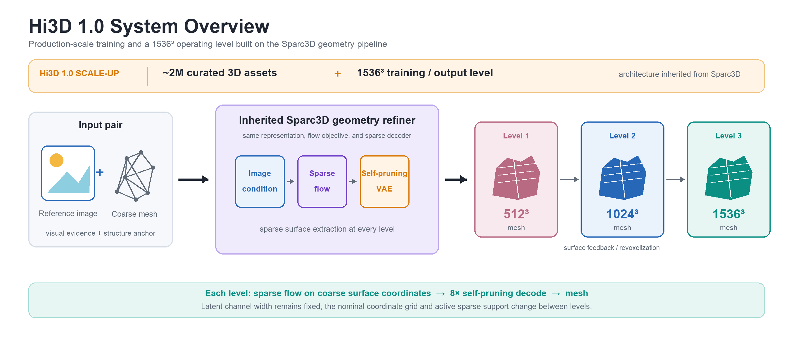
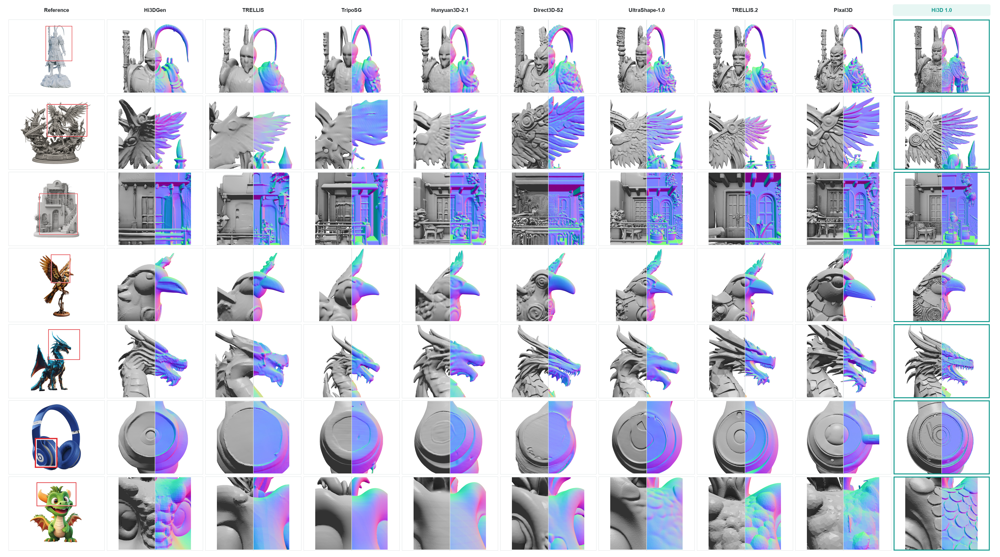
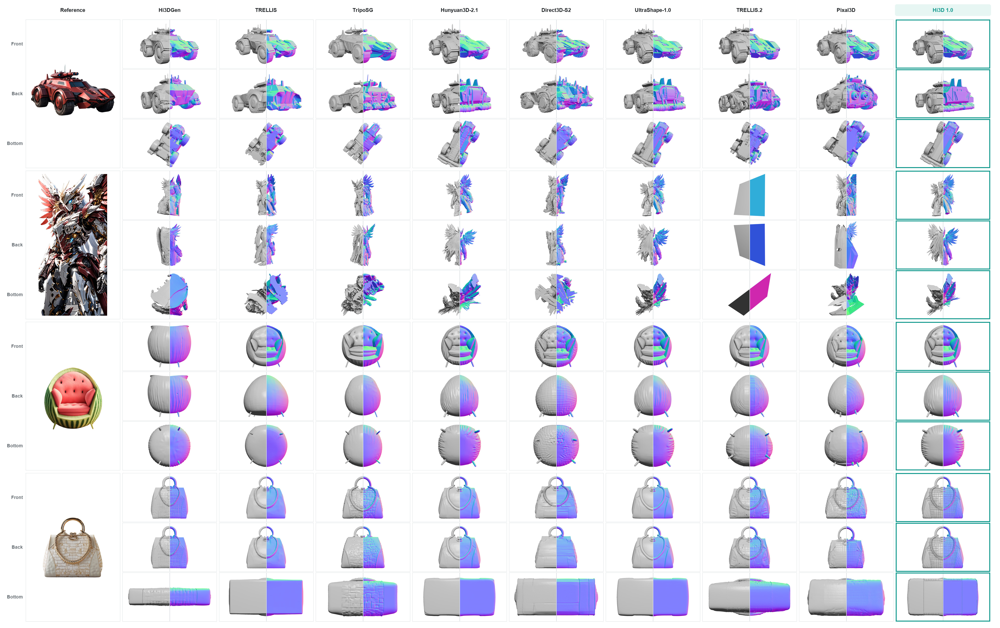
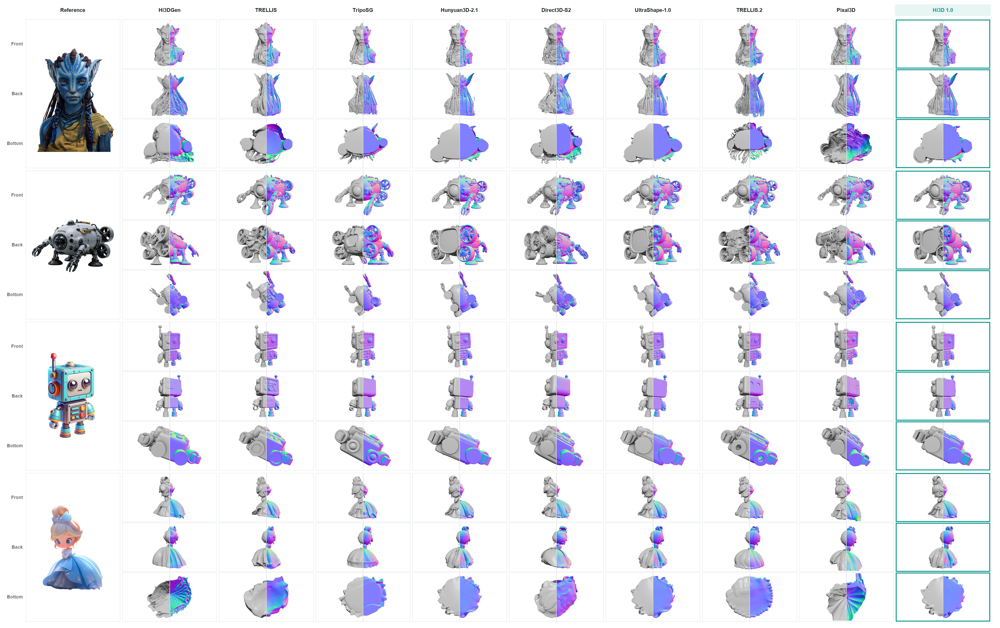

# Hi3D v1.0

<a href="README.md"><kbd>English</kbd></a> · **简体中文**

**基于 Sparc3D 的高分辨率 3D 几何细化模型。**

**[在线体验](https://huggingface.co/spaces/ilcve21/Sparc3D)** · [Hugging Face 项目主页](https://huggingface.co/hi3d-official/Hi3Dv1.0) · [国际官网](http://hi3d.ai/) · [国内官网](https://www.hi3d.cn/)

计划于 2026 年 10 月 23 日开源。

当前预览包含项目说明、系统框架与部分效果对比，代码将随正式版本发布。

## 项目介绍

Hi3D v1.0 是 Hi3D 官方推出的高分辨率 3D 几何细化项目。模型基于 Sparc3D 几何流程，以参考图和粗网格共同作为输入，通过逐级稀疏重建细化物体几何。

项目报告采用约 **200 万个精选 3D 资产**的训练规模，并支持最高 **1536³** 有效稀疏提取网格分辨率。Hi3D v1.0 沿用 Sparc3D 的表示与细化架构，重点在于训练数据规模与高分辨率几何。

## 系统框架

图像特征在粗几何所确定的稀疏坐标上为流模型提供条件；自剪枝稀疏 VAE 解码器在预测表面附近扩展特征并提取网格。相邻层级之间，将已提取的网格重新体素化，形成下一层的稀疏支撑。

| 层级 | 标称结构网格 | 稀疏提取网格 |
| --- | --- | --- |
| 1 | 64³ | 512³ |
| 2 | 128³ | 1024³ |
| 3 | 192³ | 1536³ |

以上数值表示标称稀疏坐标与表面提取分辨率，并非稠密 1536³ 潜变量张量，也不表示固定的输出三角面数。

## 效果对比

### 局部几何

红框标出各行放大的参考区域。灰模与彩色表面法线渲染共同展示层叠浮雕、建筑线脚、曲线边界、鳞片、牙齿与同心凹槽等局部结构。**最右列以青绿色标出 Hi3D v1.0。** 点击图片可查看完整分辨率。

### 多视角对比

四组物体分别展示正面、背面与底部视角。结果组合呈现灰模与彩色表面法线渲染，彩色部分不表示生成的纹理。Hi3D v1.0 以青绿色标出。

更多多视角示例

更多示例沿用上一张图的列顺序与渲染方式。

## 适用范围与局限

- **几何输出。** Hi3D v1.0 聚焦几何，不生成纹理、材质或顶点颜色。
- **依赖粗网格。** 上游粗网格提供整体结构，其中严重的结构错误可能在细化后保留。
- **遮挡区域。** 输入图不可见的几何属于合理补全，不能视为真实隐藏表面的精确重建。
- **按应用验证。** 视觉细节与标称分辨率本身不能保证网格满足特定下游工作流的要求。

## 致谢

Hi3D v1.0 基于 [Sparc3D](https://arxiv.org/abs/2505.14521) 构建，感谢原始 Sparc3D 工作及其所依托的研究。
